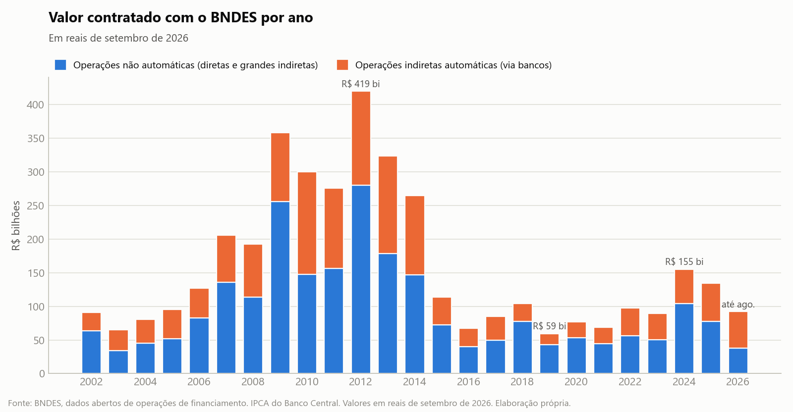
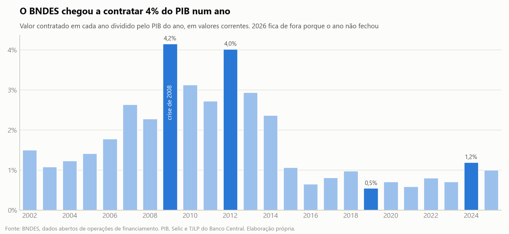
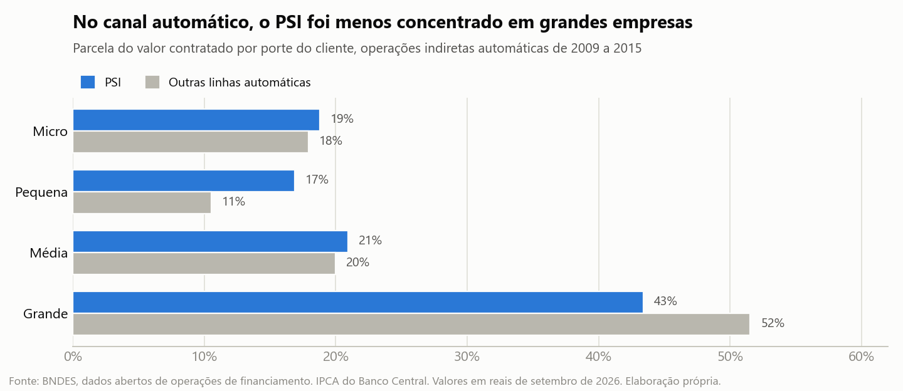
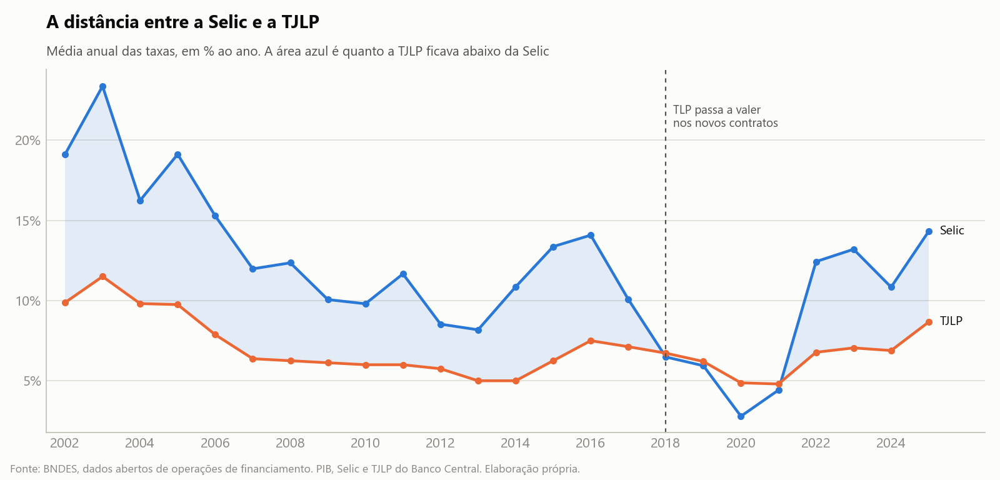
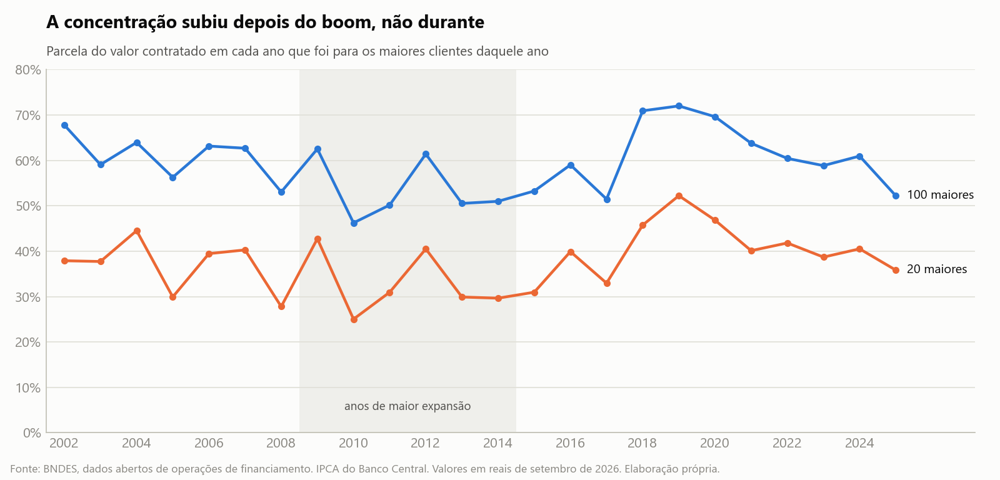
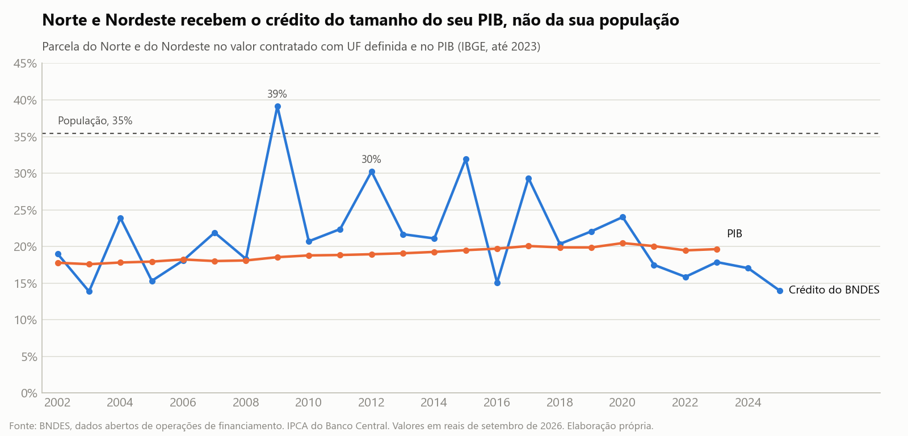
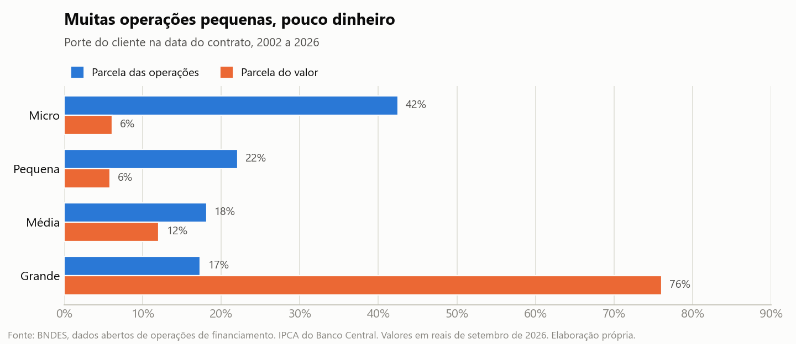
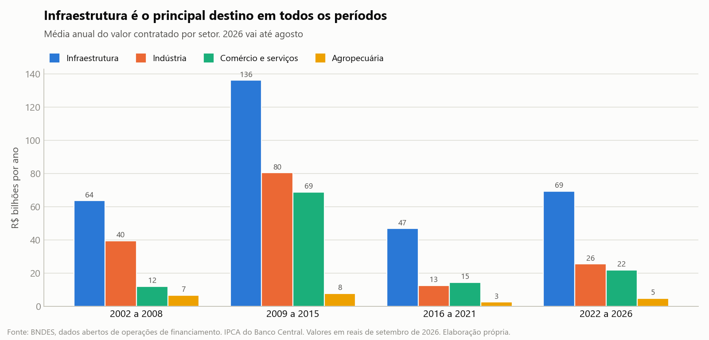

# Financiamentos do BNDES

Para onde vai o crédito do BNDES? Como os financiamentos se distribuem por setor, porte da empresa e estado, e como isso mudou ao longo do tempo? E o que os dados dizem sobre os debates que a literatura econômica trava sobre o banco?

Análise das 2.416.600 operações de financiamento contratadas com o BNDES de janeiro de 2002 a agosto de 2026, que somam R$ 3,9 trilhões em valores corrigidos pelo IPCA.

## Principais resultados

* **O BNDES foi usado como política anticíclica e depois encolheu.** O valor contratado saltou de 2,3% do PIB em 2008 para 4,2% em 2009, ano da resposta à crise financeira, e voltou a 4,0% em 2012. A partir de 2015 caiu para menos de 1% do PIB e chegou a 0,5% em 2019. Em reais de hoje, a média anual passou de R$ 323 bilhões (2009 a 2014) para R$ 81 bilhões (2016 a 2023).
* **O PSI concentrou o crédito automático do boom.** O Programa de Sustentação do Investimento somou R$ 630 bilhões de 2009 a 2015, 77% das operações feitas por bancos repassadores nesses anos, quase tudo em máquinas, caminhões e ônibus.
* **O subsídio implícito por real emprestado era maior antes do boom.** A Selic ficou de 5,6 a 11,9 pontos acima da TJLP de 2002 a 2008, e de 2,8 a 5,9 pontos de 2009 a 2014. O boom juntou uma diferença menor com um volume muito maior. De 2018 a 2021 a Selic chegou a ficar abaixo da TJLP, justo quando a TLP passou a valer.
* **Muitas operações pequenas, pouco dinheiro.** Microempresas fazem 42% das operações e recebem 6% do valor. Grandes empresas fazem 17% das operações e ficam com 76% do valor.
* **A concentração em grandes clientes subiu depois do boom, não durante.** Os 20 maiores clientes de cada ano ficaram com 25% a 43% do valor entre 2009 e 2014. Em 2019 chegaram a 52%, quando o banco encolheu e passou a financiar sobretudo grandes projetos de infraestrutura.
* **Norte e Nordeste recebem crédito do tamanho do seu PIB, não da sua população.** As duas regiões têm 35% da população e cerca de 20% do PIB. Receberam em média 25% do crédito de 2010 a 2015 e 19% de 2018 a 2025. Os picos vêm de poucos megaprojetos, como a refinaria Abreu e Lima e as usinas de Jirau e Santo Antônio em 2009 e Belo Monte em 2012.
* **Os 100 maiores clientes ficaram com 33% do valor**, entre 538 mil clientes. A Petrobras lidera, com R$ 90 bilhões, seguida pela Norte Energia (Belo Monte), pelo Estado de São Paulo e pela Vale.





## O que a literatura diz e o que os dados mostram

O BNDES é um dos bancos de desenvolvimento mais estudados do mundo. A pergunta central da literatura é se o crédito do banco gera investimento que não aconteceria sem ele ou se só barateia o financiamento de empresas que investiriam de qualquer jeito. Esta análise é descritiva e não responde a essa pergunta causal. Mas os dados permitem checar várias premissas do debate.

### Papel anticíclico

Defensores do banco argumentam que ele sustenta o investimento quando o crédito privado seca, como em 2008 e 2009. Os dados mostram o movimento com clareza. O valor contratado quase dobrou em relação ao PIB de 2008 para 2009. O banco não voltou a encolher logo depois, porém. Ficou acima de 2,4% do PIB até 2014, o que já é mais política de expansão do que resposta pontual a uma crise.

### O PSI e o que ele financiou

O Programa de Sustentação do Investimento emprestava a juros fixos baixos, com a diferença paga pelo Tesouro (equalização). O debate sobre seu efeito é intenso. Uma avaliação com controle sintético publicada pelo Ipea em 2018 não encontrou efeito significativo do programa sobre o investimento agregado. Já a revisão de Barboza, Pessoa, Roitman e Ribeiro (2023), com 48 estudos sobre o BNDES, conclui que o banco pode aumentar investimento, exportações e emprego, com efeitos maiores nas empresas menores, mas tem dificuldade de gerar ganhos de produtividade.


Uma crítica frequente é que o crédito subsidiado do pós-crise beneficiou sobretudo empresas grandes. Bonomo, Brito e Martins (2015), com dados de quase 1 milhão de firmas, mostram que empresas maiores, mais antigas e de menor risco foram as que mais ganharam com a expansão do crédito direcionado. Nos dados do BNDES, o retrato depende do canal. Nas operações automáticas, feitas por bancos repassadores, o PSI foi até menos concentrado em grandes empresas do que as outras linhas do mesmo período (43% do valor contra 52%). A concentração em grandes clientes está nas operações não automáticas, que respondem por 61% do valor total.



### A TJLP, o subsídio e a política monetária

A TJLP era fixada pelo Conselho Monetário Nacional e ficava abaixo da Selic. Isso tinha dois custos apontados pela literatura. O primeiro é fiscal, porque o Tesouro emprestava ao BNDES pagando Selic e recebendo TJLP. O segundo é monetário. O Banco Central argumentou, em estudos publicados no Relatório de Inflação, que como a TJLP quase não reagia à Selic, uma parte do crédito ficava imune aos juros, o que reduzia a potência da política monetária. Esse foi um dos argumentos para criar a TLP em 2018. Economistas como Ernani Torres Filho contestaram que o efeito fosse grande, já que o crédito é só um dos canais de transmissão.



Os dados mostram que a diferença entre as taxas mudou bastante. Foi maior antes do boom, quando chegou a 11,9 pontos (2003), e menor no auge dos empréstimos (2,8 pontos em 2012). O subsídio total do período, portanto, veio mais do volume do que da diferença de taxas. A troca pela TLP aparece de forma abrupta nos contratos.


### Campeões nacionais

Lazzarini, Musacchio, Bandeira-de-Mello e Marcon (2015) analisaram empresas de capital aberto financiadas pelo BNDES de 2002 a 2009 e concluíram que o banco subsidiava empresas que poderiam se financiar por outras fontes, sem efeito claro sobre seu desempenho ou investimento. O mesmo grupo associou parte do crédito a laços políticos e à política de "campeões nacionais", que apoiou fusões e a internacionalização de grandes grupos.

Nos dados de crédito, porém, a concentração em grandes clientes não aumentou durante o boom. Como o volume cresceu muito, os 20 maiores clientes de cada ano ficaram com uma parcela menor do total entre 2009 e 2014 do que antes ou depois. A concentração foi máxima em 2018 a 2020, quando o banco encolheu e passou a financiar sobretudo concessões de energia, transmissão e transporte. Uma ressalva importante é que boa parte da política de campeões passou pela BNDESPar, o braço de participações acionárias, que não está nesta base.




### Desigualdade regional

Um banco de desenvolvimento poderia, em tese, compensar desigualdades regionais. Um estudo publicado na revista Geosul (2020), com índices de Theil para os desembolsos de 2000 a 2018, concluiu que a distribuição foi mais equilibrada entre 2010 e 2015 e que a queda dos desembolsos depois de 2015 ampliou as disparidades. Os dados de contratação confirmam o padrão. Norte e Nordeste tiveram 25% do crédito de 2010 a 2015 e 19% de 2018 a 2025, um pouco abaixo da sua parcela no PIB (20%) e bem abaixo da sua parcela na população (35%). Os anos de maior participação coincidem com megaprojetos, o que sugere que a distribuição regional depende mais de grandes obras pontuais do que de uma política regional contínua.




### Porte e setor

A auditoria do TCU sobre a efetividade do BNDES encontrou os resultados mais positivos no apoio a micro e pequenas empresas, que têm mais dificuldade de conseguir crédito privado de longo prazo. É justamente o grupo que recebe a menor fatia do valor. A parcela das microempresas caiu de 8% do valor (2002 a 2015) para 1% (2022 a 2026), enquanto a das médias subiu de 9% a 10% para 22%.





## Referências

* Barboza, R., Pessoa, S., Roitman, F. e Ribeiro, E. P. (2023). What have we learned about national development banks? Evidence from Brazil. *Revista de Economia Política*, 43(3), 646-669. [SciELO](https://new.scielo.br/j/rep/a/hxMy6FsPF4SncsJ5tTXHpVr/?lang=en)
* Bonomo, M., Brito, R. e Martins, B. (2015). The after crisis government-driven credit expansion in Brazil, a firm level analysis. *Journal of International Money and Finance*, 55, 111-134. [Versão do Banco Central](https://www.bcb.gov.br/pec/wps/ingl/wps378.pdf)
* Lazzarini, S., Musacchio, A., Bandeira-de-Mello, R. e Marcon, R. (2015). What do state-owned development banks do? Evidence from BNDES, 2002-09. *World Development*, 66, 237-253. [Repositório Harvard](https://dash.harvard.edu/bitstream/1/15786565/1/lazzarini,musacchio,bandeira-de-mello,marcon_what-do-development-banks-do.pdf)
* Musacchio, A. e Lazzarini, S. (2014). *Reinventing State Capitalism*. Harvard University Press.
* Sachsida, A. (org.) (2018). *Políticas públicas, avaliando mais de meio trilhão de reais em gastos públicos*. Ipea. Inclui a avaliação do PSI com controle sintético.
* Torres Filho, E. T. (2017). A extinção da TJLP dá início ao desmonte do BNDES. *Jornal dos Economistas*, 334. [Biblioteca do BNDES](https://web.bndes.gov.br/bib/jspui/bitstream/1408/12056/1/A%20extin%c3%a7%c3%a3o%20da%20TJLP%20d%c3%a1%20in%c3%adcio%20ao%20desmonte%20do%20BNDES_Jornal%20dos%20Economistas%2c%20n.%20334%2c%20jun.%202017_P_BD.pdf)
* Tribunal de Contas da União. Efetividade das ações do BNDES. [TCU](https://portal.tcu.gov.br/data/files/17/F7/5A/2B/42FD18102DFE0FF7F18818A8/Efetividade%20das%20Acoes%20do%20BNDES.pdf)
* Distribuição regional dos desembolsos do BNDES de 2000 a 2018 com índices de Theil. *Geosul*, 35(74), 2020. [Periódicos UFSC](https://periodicos.ufsc.br/index.php/geosul/article/download/1982-5153.2020v35n74p132/42961/255577)
* Banco Central do Brasil. Relatório de Inflação, boxes sobre a potência da política monetária e a participação do crédito direcionado (2017 a 2020).
* Banco Mundial (2017). Nota sobre a reforma da TLP. [Documento](https://documents1.worldbank.org/curated/en/894891502429039796/pdf/117812-PORTUGUESE-PUBLIC-BR-TLP-Reform-Brief-Final-Portuguese.pdf)

## Fonte dos dados

Portal de dados abertos do BNDES, conjunto Operações de financiamento (`https://dadosabertos.bndes.gov.br/dataset/operacoes-financiamento`). São duas bases.

| Base | Operações | Conteúdo |
|---|---|---|
| Indiretas automáticas | 2.392.704 | Financiamentos feitos por bancos repassadores, sem análise caso a caso no BNDES (FINAME, BNDES Automático) |
| Não automáticas | 23.896 | Operações diretas e indiretas avaliadas pelo BNDES, com descrição do projeto |

As duas trazem cliente, UF, município, data, valor contratado e desembolsado, custo financeiro, juros, prazos, produto, setor, porte e situação. As bases vêm com dicionário de dados em PDF.

Dados auxiliares, todos baixados por `limpar.py`.

| Dado | Fonte |
|---|---|
| IPCA mensal, para corrigir a inflação | Banco Central, série 433 |
| PIB do Brasil em 12 meses | Banco Central, série 4382 |
| Selic e TJLP | Banco Central, séries 4189 e 256 |
| População por UF | IBGE, Censo 2022 (tabela 4709) |
| PIB por UF | IBGE, Contas Regionais (tabela 5938), até 2023 |

## Método

1. **Download** (`baixar_bndes.py`). O script consulta a API CKAN do portal para descobrir os arquivos do conjunto, sem depender de links fixos. O servidor às vezes fecha a conexão no meio do arquivo grande sem avisar, então o script confere o tamanho publicado e retoma de onde parou. Os CSVs ficam compactados em gzip (1,2 GB viram 121 MB).
2. **Limpeza** (`limpar.py`). Junta as duas bases numa tabela só, com os mesmos nomes de coluna. Converte valores e datas, padroniza setor e porte (a base automática escreve "INFRA-ESTRUTURA" e a outra "INFRAESTRUTURA", por exemplo) e marca as operações do PSI e as que usam a TJLP. Corrige todos os valores pelo IPCA para reais de setembro de 2026. O arquivo grande é lido em blocos, só com as colunas usadas, e o resultado é gravado em parquet.
3. **Análise** (`analisar.py`). Calcula a série anual, o tamanho do banco em relação ao PIB, o peso do PSI, o custo financeiro, a distribuição por porte, setor, UF e cliente, a concentração por ano e a parcela regional. As tabelas vão para `resultados/` e os gráficos para `figuras/`.

### Cuidados

* A análise é descritiva. Ela mostra para onde o crédito foi, não se ele gerou investimento que não aconteceria sem o BNDES.
* Os valores são o **valor contratado**, não o desembolsado. Um contrato pode ser desembolsado ao longo de vários anos e nem sempre por completo.
* **2026 vai só até agosto.** A queda em 2026 no gráfico anual não é uma tendência.
* A diferença entre Selic e TJLP é só uma aproximação do subsídio. O custo final do tomador inclui a taxa do BNDES e a do banco repassador, e nas operações do PSI o juro era fixo e equalizado pelo Tesouro.
* O porte é o da data do contrato, pela classificação do BNDES da época.
* Nas operações não automáticas, 2.603 contratos não têm UF porque são interestaduais ou no exterior. Eles respondem por 14% do valor desde 2017 e ficam fora dos cálculos regionais.
* Bancos como Banco do Brasil, Caixa e BRDE aparecem entre os maiores clientes porque recebem recursos do BNDES para repassar. O cliente final dessas operações não aparece na base.
* A base cobre só crédito. Participações acionárias da BNDESPar ficam de fora.
* O CNPJ dos clientes das operações automáticas vem mascarado, então os clientes são contados pelo nome.

## Como rodar

```bash
pip install -r requirements.txt
python baixar_bndes.py --listar   # só mostra o que existe no portal
python baixar_bndes.py            # baixa tudo (cerca de 1,2 GB, gravado em gzip)
python limpar.py                  # cerca de 1 minuto
python analisar.py
```

No Windows com Miniconda, use `rodar_bndes.bat` para o download.

Os dados não ficam no repositório. Os scripts recriam tudo a partir do portal. As tabelas de resultado e os gráficos ficam.
