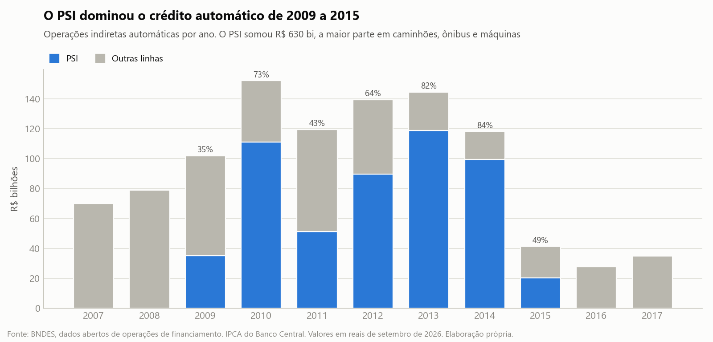
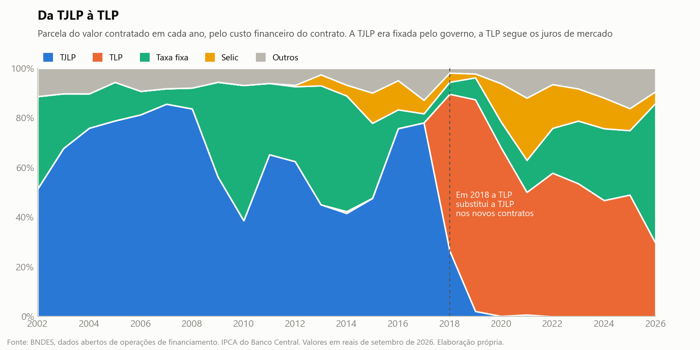
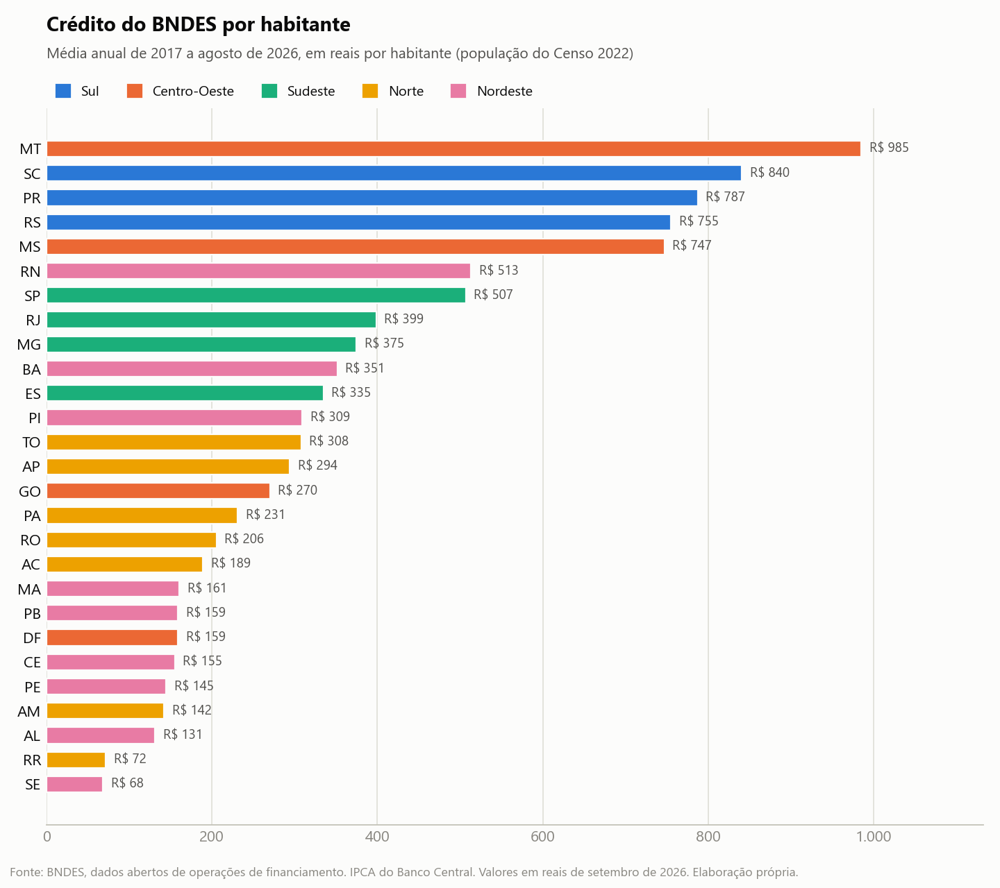
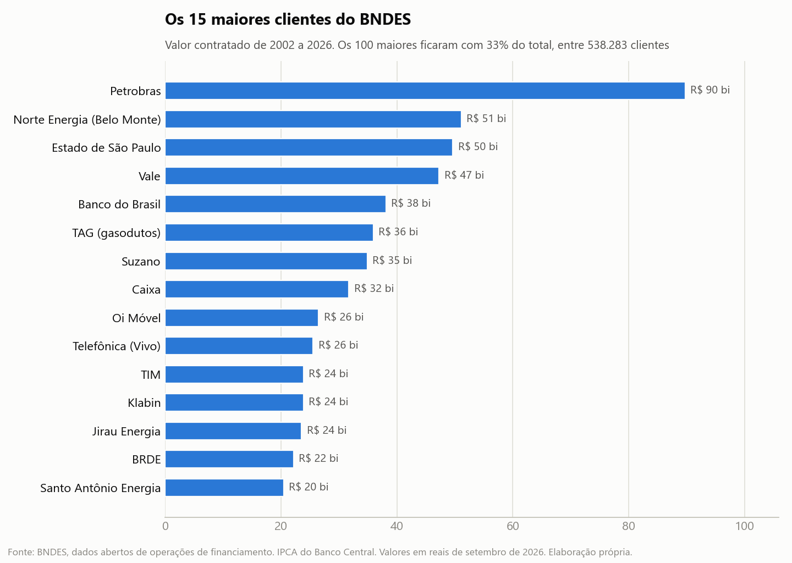

# Financiamentos do BNDES

Para onde vai o crédito do BNDES? Como os financiamentos se distribuem por setor, porte da empresa e estado, e como isso mudou ao longo do tempo?

Análise das 2.416.600 operações de financiamento contratadas com o BNDES de janeiro de 2002 a agosto de 2026, que somam R$ 3,9 trilhões em valores corrigidos pelo IPCA.

## Principais resultados

* **O crédito do BNDES caiu 75% depois de 2015.** O banco contratou em média R$ 323 bilhões por ano de 2009 a 2014, com pico de R$ 419 bilhões em 2012. De 2016 a 2023 a média foi de R$ 81 bilhões. Em 2024 o volume voltou a subir, para R$ 155 bilhões.
* **O PSI concentrou o crédito automático do boom.** O Programa de Sustentação do Investimento somou R$ 630 bilhões de 2009 a 2015, 77% das operações feitas por bancos repassadores nesses anos. Quase tudo foi para compra de máquinas e equipamentos (R$ 326 bilhões) e de caminhões e ônibus (R$ 277 bilhões).
* **A TJLP saiu de cena em 2018.** Em 2017, 78% do valor contratado usava a TJLP, taxa fixada pelo governo. Com a troca pela TLP, que acompanha os juros de mercado, a TJLP praticamente sumiu dos novos contratos a partir de 2019.
* **Muitas operações pequenas, pouco dinheiro.** Microempresas fazem 42% das operações e recebem 6% do valor. Grandes empresas fazem 17% das operações e ficam com 76% do valor. A operação média de uma grande empresa é de R$ 7,2 milhões, contra R$ 234 mil de uma micro.
* **Infraestrutura é o principal destino**, com 46% a 61% do valor em cada período. Energia elétrica e transporte rodoviário são os maiores subsetores depois de comércio e serviços.
* **Sul e Centro-Oeste recebem mais por habitante.** De 2017 a 2026, Mato Grosso liderou com R$ 985 por habitante por ano, seguido pelos três estados do Sul. A média do Sul (R$ 789) é mais de três vezes a do Nordeste (R$ 231) e a do Norte (R$ 210).
* **Os 100 maiores clientes ficaram com 33% do valor**, entre 538 mil clientes. A Petrobras lidera, com R$ 90 bilhões, seguida pela Norte Energia (usina de Belo Monte), pelo Estado de São Paulo e pela Vale.











## Fonte

Portal de dados abertos do BNDES, conjunto Operações de financiamento (`https://dadosabertos.bndes.gov.br/dataset/operacoes-financiamento`). São duas bases.

| Base | Operações | Conteúdo |
|---|---|---|
| Indiretas automáticas | 2.392.704 | Financiamentos feitos por bancos repassadores, sem análise caso a caso no BNDES (FINAME, BNDES Automático) |
| Não automáticas | 23.896 | Operações diretas e indiretas avaliadas pelo BNDES, com descrição do projeto |

As duas trazem cliente, UF, município, data, valor contratado e desembolsado, custo financeiro, juros, prazos, produto, setor, porte e situação. As bases vêm com dicionário de dados em PDF.

Para corrigir a inflação, o projeto usa o IPCA mensal da série 433 do Banco Central. Para o valor por habitante, usa a população do Censo 2022 (IBGE, tabela 4709).

## Método

1. **Download** (`baixar_bndes.py`). O script consulta a API CKAN do portal para descobrir os arquivos do conjunto, sem depender de links fixos. O servidor às vezes fecha a conexão no meio do arquivo grande sem avisar, então o script confere o tamanho publicado e retoma de onde parou. Os CSVs ficam compactados em gzip (1,2 GB viram 121 MB).
2. **Limpeza** (`limpar.py`). Junta as duas bases numa tabela só, com os mesmos nomes de coluna. Converte valores e datas, padroniza setor e porte (a base automática escreve "INFRA-ESTRUTURA" e a outra "INFRAESTRUTURA", por exemplo) e marca as operações do PSI e as que usam a TJLP. Corrige todos os valores pelo IPCA para reais de setembro de 2026. O arquivo grande é lido em blocos, só com as colunas usadas, e o resultado é gravado em parquet.
3. **Análise** (`analisar.py`). Calcula a série anual, o peso do PSI, o custo financeiro por ano, a distribuição por porte, setor, UF e cliente. As tabelas vão para `resultados/` e os gráficos para `figuras/`.

### Cuidados

* Os valores são o **valor contratado**, não o desembolsado. Um contrato pode ser desembolsado ao longo de vários anos e nem sempre por completo.
* **2026 vai só até agosto.** A queda em 2026 no gráfico anual não é uma tendência.
* O porte é o da data do contrato, pela classificação do BNDES da época.
* Nas operações não automáticas, 2.603 contratos não têm UF porque são interestaduais ou no exterior. Eles respondem por 14% do valor desde 2017 e ficam fora do cálculo por habitante.
* Bancos como Banco do Brasil, Caixa e BRDE aparecem entre os maiores clientes porque recebem recursos do BNDES para repassar. O cliente final dessas operações não aparece na base.
* O CNPJ dos clientes das operações automáticas vem mascarado, então os clientes são contados pelo nome.

## Como rodar

```bash
pip install -r requirements.txt
python baixar_bndes.py --listar   # só mostra o que existe no portal
python baixar_bndes.py            # baixa tudo (cerca de 1,2 GB, gravado em gzip)
python limpar.py                  # cerca de 1 minuto
python analisar.py
```

No Windows com Miniconda, use `rodar_bndes.bat` para o download.

Os dados não ficam no repositório. Os scripts recriam tudo a partir do portal. As tabelas de resultado e os gráficos ficam.
